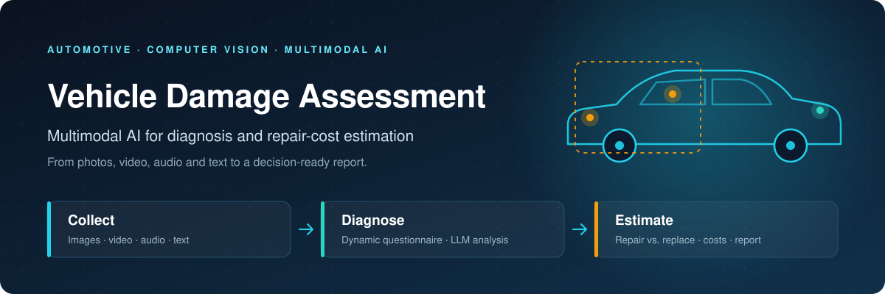
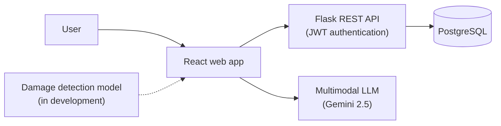

<b>Multimodal input</b> &nbsp;·&nbsp; <b>LLM-based diagnosis</b> &nbsp;·&nbsp; <b>Computer-vision detection (in development)</b> &nbsp;·&nbsp; <b>Cost and decision report</b>

> **Note:** This repository is a project showcase. The source code and the training data belong to an industrial collaboration and are kept private for confidentiality. A live demo can be provided on request.

## Motivation

Manual vehicle damage assessment is slow, subjective and hard to scale. The evidence arrives in many forms (photos, videos, voice recordings and free-text descriptions), and turning it into a reliable diagnosis, a repair-or-replace decision and a cost estimate usually depends on an expert's time.

This platform automates that workflow end to end: it collects heterogeneous user-submitted data, analyses it with multimodal AI, and produces a structured, decision-ready report.

## What the platform does

| Stage | What it does |
|---|---|
| **1. Collect** | Users submit a case with images, video, audio recordings and text descriptions, together with vehicle and insurance details. |
| **2. Diagnose** | A multimodal LLM analyses the evidence, asks dynamic clarifying questions, categorizes the damage and extracts structured information such as probable faults, driving urgency and safety recommendations. |
| **3. Estimate and report** | The system provides repair-versus-replacement decision support, estimated repair, replacement and insurance-compensation costs, and service-provider and spare-parts retailer recommendations in an exportable report. |

## Key features

- **Flexible services:** diagnostics, insurance assessment, or both, plus a quick-analysis mode for fast image-based questions.
- **Dynamic questionnaire:** follow-up questions are generated from the evidence that has already been submitted, and user feedback on the diagnosis is stored with the case.
- **Interactive vehicle schematic:** damaged parts are marked on a vehicle diagram, with part-level detail views.
- **Financial analysis:** charts for repair and replacement costs, price analysis and claimable items.
- **Vehicle history:** vehicles are looked up by VIN or plate, with previous claims and diagnostics attached.
- **Audio guidance:** text-to-speech support for guided interaction.
- **Exportable reports** for service providers and insurers.

## Architecture

I designed and built the platform end to end: the web application, the REST API, the data model, the multimodal AI pipeline and the reporting workflow.

## Data model and API

The PostgreSQL schema covers users and credentials, vehicles, cases, insurance details, evidence, diagnosis feedback, reports and vehicle claims history. A Flask REST API with more than 20 endpoints and JWT authentication exposes these resources.

## Computer-vision damage detection (in development)

A computer-vision model trained on proprietary data from the partner company is being developed to identify vehicle damage automatically and feed the assessment pipeline. Training and evaluation are in progress.

## Technology

- **Frontend:** React · TypeScript · Vite
- **Backend:** Python · Flask · SQLAlchemy · Flask-JWT-Extended · REST API
- **Database:** PostgreSQL
- **AI:** multimodal LLM · computer-vision damage detection (in development)
- **Deployment:** Docker

## My role

I designed and developed the entire platform: system architecture, data model, REST API, web application, the multimodal AI pipeline and the reporting workflow. I am also developing the computer-vision component.

## Status

In active development since October 2025, in collaboration with an automotive after-sales and roadside assistance provider.

## Contact

Niusha Shamsikhani · niusha.s2015@gmail.com
